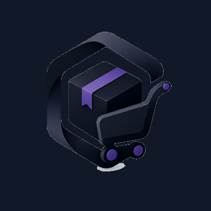

  

# ShopUp Panel

**App Android de punto de venta (POS) y gestión para negocios con tienda ShopUp.**
Funciona sin internet: todo se guarda en el dispositivo y se sincroniza con tu negocio cuando hay conexión.

  

## Qué hace

- **POS que no se cae sin señal**: registra ventas y cobros aunque no haya internet. Todo queda guardado en el teléfono y se sube solo al reconectar; lo que falta por subir aparece marcado como *Pendiente de subir*.
- **Productos y stock**: busca, revisa precios y existencias por ubicación, corrige precios y cantidades desde el móvil (los cambios hechos sin conexión se reflejan al instante en la app).
- **Pedidos e historial**: consulta y gestiona pedidos y el histórico de movimientos del negocio.
- **Cuadre de caja**: apertura y cierre de caja desde el móvil, también sin conexión, con reconciliación automática al sincronizar.
- **Reportes**: ventas y KPIs del negocio en el momento.
- **Roles y permisos**: Dueño, Almacenero y Vendedor con los mismos permisos que en el panel web. Quien no tiene un menú no lo ve dentro de la app.
- **Anuncios y notificaciones** del negocio, con enlace directo a tu **tienda virtual**.
- **Tour guiado** por cada pantalla y **actualizaciones desde la propia app** (te avisa si quedan datos sin sincronizar antes de instalar una versión nueva).

Todos los datos viven primero en el dispositivo (SQLite offline-first) y se sincronizan con el negocio configurado en tu web ShopUp.

## Instalación

1. Descarga el APK con el botón de arriba.
2. Al abrirlo, Android pedirá autorizar **«instalar de fuentes desconocidas»** para tu navegador o gestor de archivos: permítelo.
3. Instala, ábrelo e inicia sesión con los datos de tu negocio (los mismos del panel web).

Requisitos: **Android 7.0 o superior** · paquete `com.shopup.panel` · ~82 MB libres.

## Actualizaciones

La propia app detecta cuando sale una versión nueva y te guía para instalarla. También puedes volver aquí en cualquier momento: **este enlace siempre sirve la última APK publicada**.

| | |
|---|---|
| Versión actual | **0.6.11** (build 611) |
| Publicada | 19 de octubre de 2026 |

## Sobre este repositorio

Este repo es **público únicamente con el APK compilado** para que cualquier usuario pueda descargarlo sin cuenta. El código fuente del proyecto vive en un repositorio privado.
